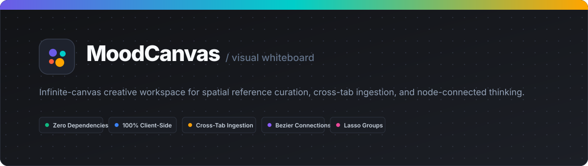
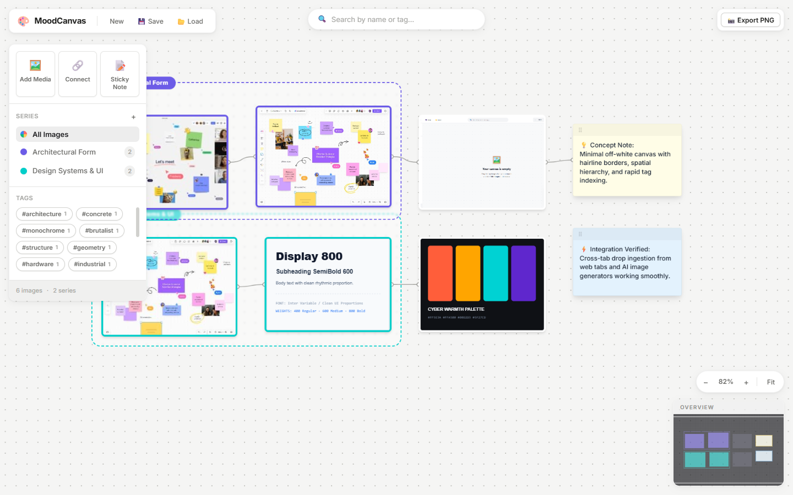
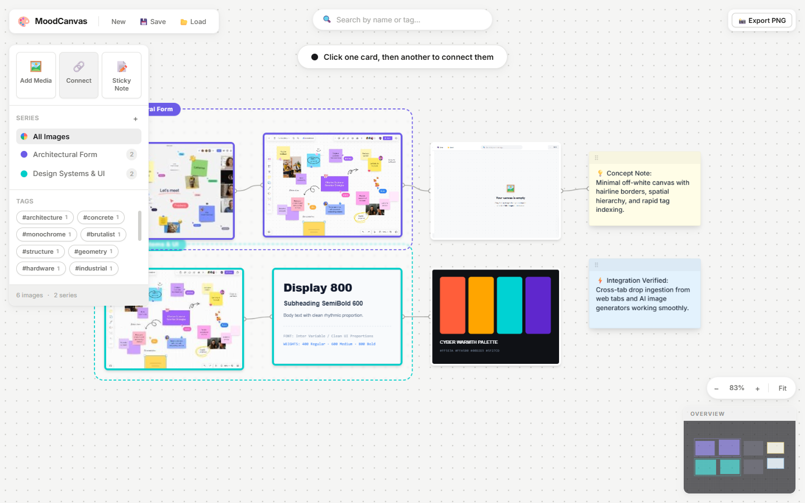
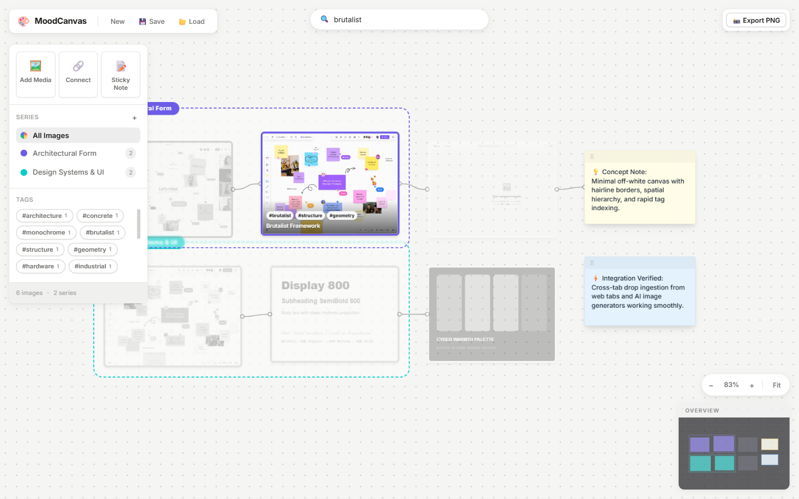

<p align="center">
  
</p>

<p align="center">
  <strong>An infinite-canvas visual whiteboard engineered for spatial moodboarding, media curation, and connected ideation.</strong>
</p>

<p align="center">
  
  
  
  
  
</p>

---

## Overview

**MoodCanvas** provides an unconstrained, clutter-free infinite canvas designed for designers, researchers, and creators. Instead of rigid boards or heavy cloud suites that lock your data behind accounts, MoodCanvas is completely client-side, lightweight, and works natively in your browser with zero build steps or database configuration.

<p align="center">
  
  <em>Full MoodCanvas workspace with categorized series, active bezier node connections, brutalist tags, sticky notes, and live minimap overview.</em>
</p>

---

## Key Features

### ♾️ Infinite Spatial Canvas
- Smooth **viewport pan & zoom** with customizable magnification levels (10% to 300%).
- Infinite coordinate space supporting hundreds of images, sticky notes, and video clips simultaneously.
- Automatic boundary calculation with **Fit All** auto-centering.

### 🌐 Cross-Tab Drag & Drop Ingestion
- Seamlessly click, hold, and drag generated assets from **ChatGPT, Midjourney, Google Images, or any browser tab** directly onto MoodCanvas.
- Intelligent URL extraction fetches media and embeds it into the board for reliable offline exports.
- Graceful CORS fallback guarantees that even protected third-party images remain viewable on your canvas.

### 🎥 Multi-Format Media Support
- Support for images (`PNG`, `JPG`, `JPEG`, `WebP`, `SVG`, `GIF`).
- Support for embedded video playback (`MP4`, `WebM`) with customized inline playback toggles.
- Intelligent aspect ratio preservation and automatic resizing on initial placement.

### 🔗 Node Connections & Visual Flows
- Toggle **Connect Mode** with one click or shortcut.
- Click any source card and click a target card to generate smooth **SVG cubic bezier curves**.
- Cards can be moved freely while connections adapt dynamically in real time.

<p align="center">
  
  <em>Interactive Bezier connection mode: visually mapping creative references, thoughts, and layout relationships.</em>
</p>

### 🪢 Lasso Group Selection
- Bulk-assign multiple cards to a series collection in seconds.
- Trigger the lasso tool from any series card, then drag a marquee bounding box across your canvas. Every card enclosed inside the box is instantly grouped.

### 🏷️ Brutalist Quick-Tagging & Filtering
- Every card features a semi-brutalist quick-action button in the bottom corner for rapid tag entry.
- Real-time tag index in the floating sidebar counts active occurrences.
- Instant search bar isolates matching cards with high-contrast spotlighting while gently dimming irrelevant items.

<p align="center">
  
  <em>Instant search query ('brutalist') isolating matching cards while maintaining ambient canvas context.</em>
</p>

### 🗺️ Interactive Minimap
- Dynamic bird's-eye canvas radar with color-coded nodes matching each item's series.
- Viewport indicator shows current camera position in real time.
- Click anywhere on the minimap to instantly jump your canvas viewport to that coordinate.

### 📸 High-Resolution Export Engine
- **Custom Region Export**: Drag a rectangular marquee to crop and render only the selected area as high-resolution PNG.
- **Full Canvas Export**: Capture the entire infinite board with all series frames, cards, and connections in one clean image.

### 💾 Portable `.moodcanvas` State Persistence
- Save and load your entire board with all metadata, series, tags, connections, and embedded media into a single portable `.moodcanvas` JSON file.
- Everything runs on your machine: zero analytics, zero external telemetry, zero server storage.

---

## Visual Architecture & Directory Structure

```
moodcanvas/
├── index.html              # Core application DOM and floating control overlay
├── style.css               # Techno-minimalist design system, dot grid & card styling
├── js/
│   ├── app.js              # Application entry point, event dispatch & demo loader
│   ├── board.js            # Immutable state store (images, notes, series, connections)
│   ├── canvas.js           # Infinite canvas viewport engine, drag-drop, pan & zoom
│   ├── export.js           # Canvas & crop-region PNG exporter
│   ├── lasso.js            # Marquee lasso selection engine for series assignment
│   ├── minimap.js          # Interactive canvas radar and viewport synchronizer
│   ├── sidebar.js          # Series collections, tags index & asset inspector
│   ├── storage.js          # Local .moodcanvas serialization and file I/O
│   └── utils.js            # Color palettes, math geometry, UUID & toast helpers
├── assets/
│   ├── banner.svg          # Project presentation banner
│   └── demo/               # Sample graphics and architectural assets
├── docs/
│   └── screenshots/        # High-resolution application screenshots
├── .env.example            # Environment configuration template
├── .gitignore              # Strict ignore rules for credentials, keys, and logs
├── LICENSE                 # MIT License
└── README.md               # Documentation
```

---

## Quick Start

MoodCanvas has **zero build dependencies**. You can clone and run it instantly:

```bash
# Clone the repository
git clone https://github.com/manojkumarv2508-cmyk/moodcanvas.git

# Enter the project folder
cd moodcanvas
```

### Launch Locally

**Option A: Python 3**
```bash
python -m http.server 3000
```
Open [http://localhost:3000](http://localhost:3000)

**Option B: Node.js (npx)**
```bash
npx serve .
```

**Option C: Direct Browser Launch**
Double-click `index.html` to open directly in Google Chrome, Microsoft Edge, Firefox, Brave, or Safari.

> **Tip:** Open [http://localhost:3000/?demo=1](http://localhost:3000/?demo=1) to instantly launch the pre-populated demo board with sample cards, connections, and series collections!

---

## Keyboard Controls & Shortcuts Reference

| Action | Control / Shortcut |
| :--- | :--- |
| **Pan Canvas** | `Space + Click & Drag` or `Middle Mouse Drag` |
| **Zoom Viewport** | `Ctrl + Mouse Wheel` or `Cmd + Mouse Wheel` |
| **Fit All Items** | Click **Fit** button in bottom zoom bar |
| **Move Card** | Click & drag card header bar |
| **Resize Card** | Click & drag bottom-right corner resize handle |
| **Connect Nodes** | Click **Connect**, click first node, then click second node |
| **Lasso Multi-Select** | Click target icon on any series item, drag bounding box |
| **Quick Tag** | Click `+` button in bottom corner of any image card |
| **Edit Card Info** | Double-click card to open detailed sidebar editor |
| **Save Board State** | `Ctrl + S` or `Cmd + S` |
| **Delete Card** | Select card and press `Delete` or `Backspace` |
| **Clear Selection / Search**| Press `Escape` |

---

## Security & Privacy Protocol

MoodCanvas is built from the ground up to protect user privacy and sensitive intellectual property:
- **100% Client-Side**: No external analytics, telemetry, or server database.
- **Strict Git Rules**: Pre-configured `.gitignore` prevents `.env`, `*.key`, `*.pem`, `*.credentials`, system metadata, and debug logs from ever entering version control.
- **Environment Template**: `.env.example` is supplied so developers can safely configure environment variables for optional backend sync without exposing real credentials.

---

## Deployment

Deploying MoodCanvas is instant because the project root contains `index.html`:

- **GitHub Pages**: Go to repository **Settings** → **Pages** → select `main` branch `/ (root)` → Save.
- **Netlify**: Drag and drop the repository folder directly into Netlify Drop, or connect via Git.
- **Vercel**: Import the GitHub repository; Vercel automatically deploys it as a static site.

---

## Contributing & License

Contributions, feedback, and feature suggestions are welcome! Feel free to open an issue or pull request.

Distributed under the **MIT License**. See [LICENSE](LICENSE) for full details.
